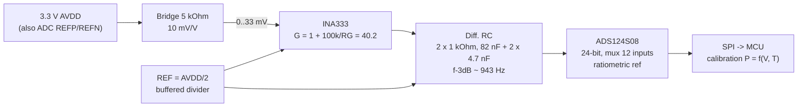
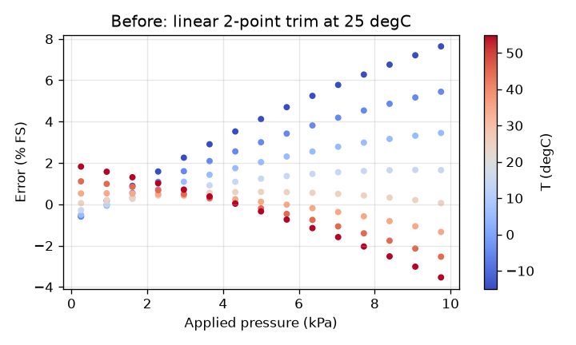
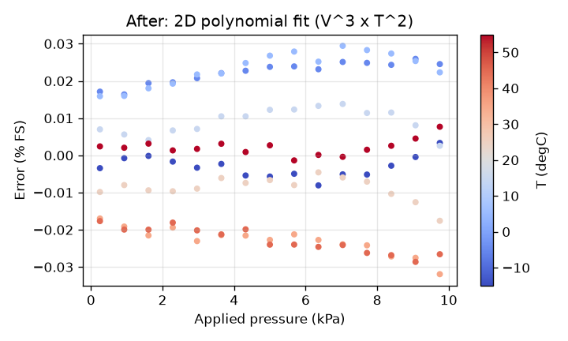

# pressure-frontend

Design study of a multi-channel front-end for piezoresistive pressure sensors, of the kind used on
multi-hole flow probes: bridge, instrumentation amplifier, anti-alias filter, 24-bit delta-sigma ADC.
It includes ngspice netlists, a Python error/noise budget with Monte Carlo, and a pressure x temperature
calibration fit on synthetic sensor data. CI runs the SPICE checks and the tests.

**Status: design and simulation only.** No PCB was built, nothing was measured, and the sensor data
is synthetic. This is a personal project and is not affiliated with any company.

## Block diagram

One INA plus RC per sensor, one muxed ADC for all channels (ADS124S08 has 12 analog inputs, so up
to 6 differential channels plus a temperature input on one device; a 5- or 7-hole probe needs one or two ADCs).

## Design choices and why

| Choice | Why |
|---|---|
| Ratiometric excitation: bridge and ADC reference both from AVDD | Bridge output and ADC full scale scale together, so excitation drift and noise cancel to first order. No precision reference needed for the bridge. |
| INA333 (TI SBOS445) | Zero-drift (chopper), so offset drift and 1/f noise are small at the low frequencies of interest. Runs on 1.8 to 5.5 V, low supply current per channel. Gain set by one resistor. |
| G = 40.2 (RG = 2.55 kOhm) | 33 mV full scale becomes 1.33 V, inside the +-1.65 V window around REF with headroom for offset and overpressure. |
| REF = AVDD/2, ADC AINN tied to the same REF node | The ADC measures INA output minus REF, so REF error is common-mode and drops out. |
| RC corner about 943 Hz | Well above the pressure bandwidth of interest (tens of Hz per channel at 100 SPS), far below the ADS124S08 modulator rate of 256 kHz, so the single pole gives about 51 dB at the modulator frequency (simulated) where the digital filter has no rejection. Also limits the kickback from the ADC sampling cap. C_CM is 10x smaller than C_DIFF so CM capacitor mismatch converts little CM noise to differential. |
| ADS124S08 (TI SBAS660) | 24-bit delta-sigma, input mux, external reference inputs for the ratiometric scheme, data rates 2.5 to 4000 SPS. PGA bypassed because the INA already provides gain. |
| 2D polynomial calibration (V^3 x T^2, 12 coefficients) | Bridge offset, span, their temperature coefficients and the bow nonlinearity are all smooth; a low-order surface removes them without overfitting a 99-point grid. |

## SPICE (ngspice)

`spice/frontend.cir` is one channel with behavioural parts: an INA built as the classic 3-op-amp
topology with 50 kOhm feedback resistors (as inside the INA333), single-pole op amps at 350 kHz GBW,
and two 75.5 kOhm input resistors whose thermal noise equals 50 nV/rtHz, standing in for the INA
voltage noise. No vendor model is bundled. `spice/run.cir` runs `.op`, `.ac` and `.noise` and prints
measurements; `spice_check.py` parses them and the tests compare against the design values.

| Check | Simulated | Expected |
|---|---|---|
| DC and AC gain | 40.21 | 40.22 (1 + 100k/2.55k), tolerance 1 % |
| -3 dB corner, full chain | 930 Hz | 943 Hz from the RC alone, tolerance 5 % (INA pole pulls it down slightly) |
| Attenuation at 256 kHz | -50.9 dB | < -45 dB |
| Input-referred noise 0.1 Hz to 1 kHz | 1.63 uV rms | 1.4 to 2.0 uV rms |

Run locally: `ngspice -b spice/run.cir` (or set `NGSPICE` to the binary and run `python spice_check.py`).
The netlist uses plain SPICE elements, so it should also open in LTspice after removing the
`.control` block (LTspice uses `.meas` and `.noise` directives instead); not tested in LTspice.

## Error and noise budget

Example sensor: 0 to 10 kPa, 10 mV/V, 3.3 V excitation, so 3.3 uV/Pa. Temperature excursion from
calibration conditions: 20 degC. Data rate 100 SPS per channel. Output of `python budget.py`:

| Term | Raw (Pa) | Raw (% FS) | After cal (Pa) | After cal (% FS) |
|---|---|---|---|---|
| Bridge offset +-2 mV/V | 2000.00 | 20.0000 | 0.00 | 0.0000 |
| Bridge span tolerance +-20 % | 2000.00 | 20.0000 | 0.00 | 0.0000 |
| INA offset | 8.14 | 0.0814 | 0.00 | 0.0000 |
| INA offset drift x dT | 0.68 | 0.0068 | 0.68 | 0.0068 |
| INA gain error | 25.00 | 0.2500 | 0.00 | 0.0000 |
| INA + RG gain drift x dT | 7.00 | 0.0700 | 7.00 | 0.0700 |
| Excitation/reference drift (ratiometric) | 0.00 | 0.0000 | 0.00 | 0.0000 |
| INA voltage noise (rms) | 0.11 | 0.0011 | 0.11 | 0.0011 |
| Bridge thermal noise (rms) | 0.02 | 0.0002 | 0.02 | 0.0002 |
| ADC noise (input referred) (rms) | 0.03 | 0.0003 | 0.03 | 0.0003 |
| Quantisation (rms) | 0.00 | 0.0000 | 0.00 | 0.0000 |
| Calibration fit residual (max) | | | 3.19 | 0.0319 |
| **RSS total** | 2828.6 | 28.286 | 7.73 | 0.0773 |

Monte Carlo (20000 runs, after cal): 95th percentile |error| = 6.88 Pa = 0.069 % FS.
Total rms noise 373 nV input referred = 0.11 Pa rms, about 16.4 bits effective resolution over the sensor span.

Reading it: the raw number is dominated by the sensor die itself, which is why calibration is not
optional. After calibration the largest term is gain drift of the INA plus the RG resistor, so the
first hardware improvement would be a lower-TC RG (or calibrating at the operating temperature),
not a better ADC. Noise is far below the static terms at 100 SPS.

Values used (re-check against the current datasheet revisions):
INA333: Vos max 25 + 75/G uV, drift max 0.1 + 0.5/G uV/degC, e_n 50 nV/rtHz, gain error max 0.25 %,
gain drift 10 ppm/degC excluding RG. ADS124S08: modulator 256 kHz at 4.096 MHz clock, 24 bit.
**ADC noise of 4 uV rms at 100 SPS, gain 1 is a conservative assumption**, not a value read from the
noise table; it is divided by G = 40 so it barely matters here.

## Calibration

`calibrate.py` generates a synthetic bridge output with offset, TCO, span, TCS (about -0.2 %/degC)
and a 0.6 % FS bow nonlinearity, plus input-referred noise from the budget, on an 11 x 9 grid
(0 to 10 kPa, -20 to 60 degC). It fits P = sum c_ij vn^i tn^j, validates on a different 15 x 8 grid,
and writes `docs/calibration_table.csv` (coefficients) and `docs/calibration_summary.json`.

| | Max abs error on validation grid |
|---|---|
| Linear 2-point trim at 25 degC | 764 Pa (7.6 % FS) |
| 2D polynomial | 3.2 Pa (0.032 % FS), rms 1.7 Pa |

## Tests

`pytest -q`: 10 tests. SPICE gain, corner, alias attenuation and noise checks (skipped locally if
ngspice is missing, required in CI), design sanity checks, budget checks, known-coefficient recovery
of the polynomial fit, and before/after residual thresholds.

## Limitations

- Design and simulation only. No schematic capture, no PCB, no prototype, no measurements.
- Behavioural amplifier model, not the vendor model: no CMRR, input bias current, chopper ripple,
  output swing limits or PSRR in the simulation.
- The ADC is not simulated; its contribution is a number in the budget, and its noise figure is an assumption.
- Sensor data is synthetic from a made-up model; real dies have hysteresis, long-term drift and
  package stress effects that are not modelled.
- Budget is worst case at full scale with simple RSS and uniform distributions; mux settling,
  channel-to-channel crosstalk and EMI are not covered.
- Not affiliated with any sensor or probe manufacturer.
